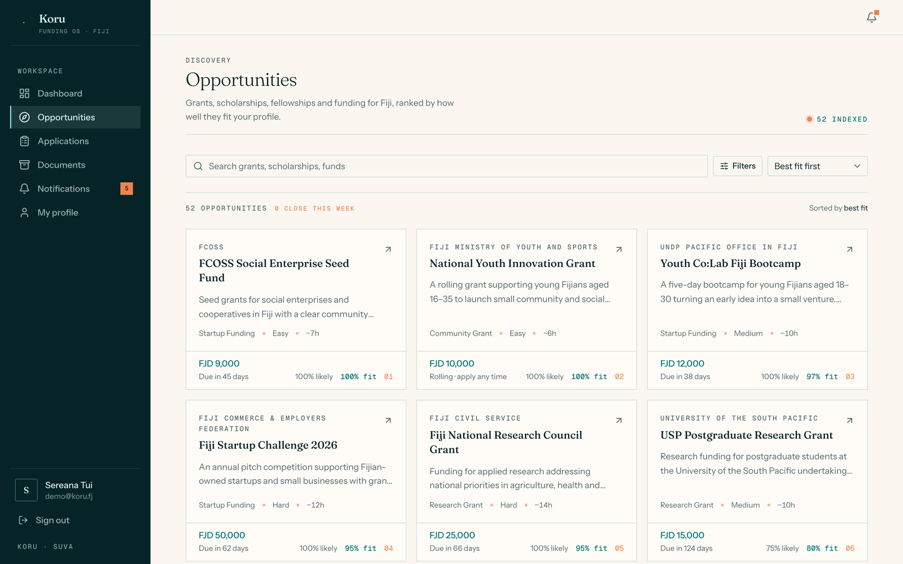
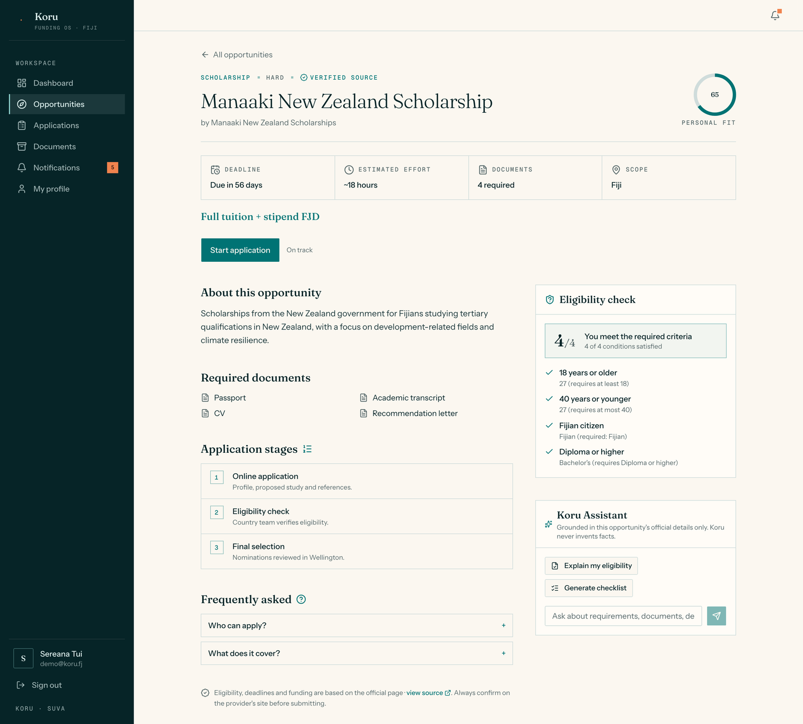
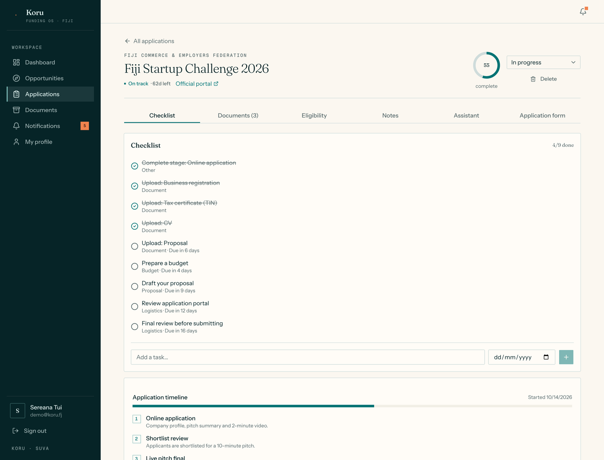
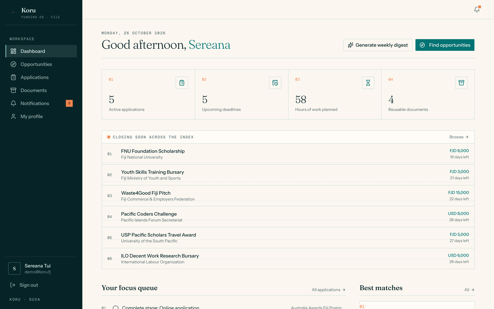
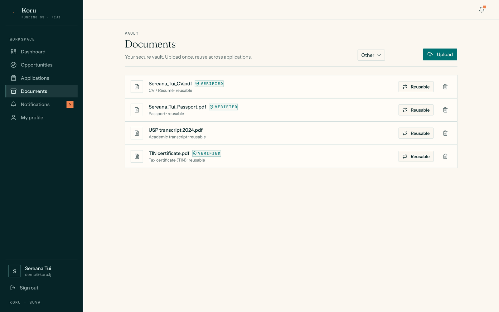

# Koru: the funding OS for Fiji


> [!NOTE]
> Koru is a **working prototype**, built to see how far one person could take the idea "grants and scholarships, finished not just found". It runs entirely on your own machine with **seeded demo data**. The 52 listings in the catalogue are illustrative, not a live feed, so always confirm a deadline or rule on the funder's own site. See [Honest limits](#honest-limits).

Funding in Fiji is spread across ministries, UN agencies, regional bodies and bilateral donors, announced on Facebook pages and in PDFs that contradict each other. Koru puts it in one place and then goes further than a directory: it **checks your eligibility rule by rule**, **plans the application** (documents, stages, deadlines) and **reminds you** before each deadline. The product thinking is in the [written product report](docs/report.md).

## Contents
[Screenshots](#screenshots) · [Core features](#core-features) · [How the eligibility engine works](#how-the-eligibility-engine-works) · [Bugs found and fixed](#bugs-found-and-fixed-in-the-cleanup) · [Tech stack](#tech-stack) · [Every integration has a local mode](#every-integration-has-a-local-mode) · [Honest limits](#honest-limits) · [Privacy](#privacy) · [Running locally](#running-locally) · [License](#license)

## Screenshots

All screenshots are the real app running on the seeded demo database, signed in as a **fictional** demo persona (Sereana Tui, 27, agriculture sector).

**Landing page.** The headline states the position; the ledger on the right is read live from the database.


**Opportunities, ranked by fit.** 52 listings with a fit score and a likelihood of eligibility for the signed-in profile.



**The eligibility check.** Every rule on the Manaaki New Zealand Scholarship is evaluated on its own, with the profile value shown next to what is required.



**An application workspace.** A task plan generated from the opportunity's required documents and stages, an application timeline, and tabs for documents, eligibility, notes, an assistant and the application form.



<details>
<summary><strong>Two more screens</strong> (dashboard, document vault)</summary>





</details>

## Core features

- **Eligibility, rule by rule.** Each opportunity carries explicit rules (age, citizenship, education, sector, organisation type, business stage, experience, interests, documents held). Koru returns a yes or no per rule with the reason, never a black-box score.
- **A fit score you can recompute.** `round(100 × (0.7 × required rules met + 0.3 × interest match))`, minus a small penalty for hard opportunities. Every number on screen is traceable to a rule.
- **Application plans.** Opening an application builds a checklist from the listing's required documents, stages and logistics, ordered against the deadline.
- **Document vault.** Upload a transcript or ID once and reuse it across applications. Required documents the user already holds feed back into eligibility.
- **Reminders.** Notifications at 14, 7, 3 and 1 days before a deadline.
- **Guided application form.** A "fill and finish" form that pre-fills answers from the profile.
- **Optional assistant.** Explain my eligibility, generate a checklist, summarise or rewrite text. Prompts are built only from the listing's official fields, its rules and your profile; without an OpenAI key a deterministic local provider answers instead.

## How the eligibility engine works

The engine is a pure function (`src/lib/eligibility.ts`): rules in, per-rule results out, no AI involved. These are real outputs for the seeded **Manaaki New Zealand Scholarship** (rules: age 18 to 40, Fijian citizen, Diploma or higher), produced by running the engine and fit scorer on the profiles below.

| Profile typed in | Required rules met | Eligible | Fit* | What Koru tells you |
|---|---|---|---|---|
| 27, Fijian, Bachelor's | 4 / 4 | yes | 80 | All criteria met |
| Citizenship typed as `fijian ` (lowercase, trailing space) | 4 / 4 | yes | 80 | Treated as Fijian |
| Citizenship typed as `Fiji` | 3 / 4 | no | 63 | "Fijian citizen: Fiji (required: Fijian)" |
| Age 41 | 3 / 4 | no | 63 | "40 years or younger: 41 (requires at most 40)" |
| Education: Secondary | 3 / 4 | no | 63 | "Diploma or higher: Secondary (requires Diploma or higher)" |
| Age left blank | 2 / 4 | no | 45 | "Age is not set on your profile." (both age rules) |

\* With no funding interests set, which counts as a neutral 0.5 for the interest part. The Manaaki listing is "hard", so 5 points come off.

A missing profile field never counts as a pass, and the message says which field to fill in. That is the behaviour you want from a tool people use to decide where to spend a weekend of paperwork.

## Bugs found and fixed in the cleanup

Running the app from a clean checkout, and probing the engine with ordinary inputs, found real defects that reading the code did not.

| Found by | Problem | Fix |
|---|---|---|
| Setting up from a fresh clone | The schema had an `Application.formAnswers` column that **no migration created**. `prisma migrate deploy` plus `db seed` failed, and the application page would crash on any new database. The author's local database had been built with `db push`, which hid it. | Added the migration. `prisma migrate diff` between the migrations and the schema is now empty. |
| Typing realistic input into the profile | Citizenship is free text, but the engine compared it **case-sensitively**: `fijian`, `FIJIAN` or `Fijian ` (a trailing space from phone autocomplete) failed the "Fijian citizen" rule, marking a Fijian ineligible for the 24 opportunities that require it. `eq` and `in` also disagreed with each other. | One normalisation helper (trim + lowercase) for every text comparison. 16 new tests; 10 of them fail on the old engine. |
| Repository hygiene | `.gitignore` had `.env*`, so a `.env.example` could never be committed, and the uploads folder was not ignored, so users' documents could be committed by accident. | Added `!.env.example` and `/.koru-uploads/`. |
| Comparing the report with the code | The product report said the engine made Manaaki "postgraduate-only for Fijians". The seeded rule is "Diploma or higher", and sources disagree about the real rule ([one aggregator](https://www.scholars4dev.com/2026/02/18/new-zealand-development-scholarships-for-africans-asians-latin-americans-and-pacific-islanders/) says postgraduate only for Fiji, [AUT's FAQ](https://www.aut.ac.nz/study/fees-and-scholarships/scholarships-and-awards-at-aut/manaaki-new-zealand-government-scholarships/manaaki-new-zealand-scholarships-faqs) lists Fiji without that limit and notes eligibility changes yearly). The test count was also stale. | The report now describes what the rules actually say; counts updated. |

## Tech stack

**App**
- Next.js 16 (App Router, server actions, Turbopack) and React 19
- TypeScript, Tailwind CSS v4, shadcn/ui and Radix primitives
- Fraunces, Instrument Sans and Geist Mono, in a hand-built editorial design system (described in the report)

**Data**
- Prisma 7 over `better-sqlite3` (single-file database; lists stored as JSON text)
- Zod for input validation

**Integrations (all optional)**
- OpenAI for the assistant, Resend for email, Supabase Storage for documents

**Quality**
- Vitest: 88 unit tests across eligibility, matching, plan generation, deadlines, JSON handling and smart-fill
- `tsc --noEmit` and ESLint are clean; the production build compiles 13 routes

## Every integration has a local mode

Nothing needs an account to run. Each service falls back to something deterministic and local when its key is absent:

| Concern | With a key | Without (default) |
|---|---|---|
| Assistant and drafting | OpenAI | A deterministic local provider |
| Email (reminders, digest) | Resend | Printed to the server log |
| Document storage | Supabase Storage | Files under `.koru-uploads/` |
| Opportunity sync | URL adapters fetch the source page | Offline sample adapters per source |

## Honest limits

- **Sign-in is demo-grade.** Entering an email creates or opens that account, with no password and no verification, so anyone who knows an address can open that account and its documents. The sessions themselves are sound (random 256-bit tokens, stored hashed, HttpOnly, SameSite=Lax), but this needs a real identity provider before any real deployment. Do not host it with real people's documents.
- **The catalogue is demo content.** The 52 hand-written listings are illustrative and may be out of date. `npm run catalogue` adds synthetic listings that point at placeholder `example-*.org` links, so those are never real funding data.
- **Sync is a sample.** The source adapters ship as offline samples. The URL adapter exists but has not been hardened or validated against real funder sites.
- **Citizenship is free text.** After normalising case and spaces it must still equal `Fijian`; `Fiji` does not match. A dropdown would be the proper fix.
- **Single instance.** A SQLite file and local-disk uploads mean one server process, not a scaled deployment.
- **Not tested with real users.** There has been no accessibility audit and no measurement on slow connections; the low-data, mobile-first goal in the report is a design aim, not a measured result.

Security checks that were run against the live server: unauthenticated API calls return 401; uploads reject HTML, empty files and anything over 10 MB; a file is served only to the user who owns it (another signed-in user gets 404); and path-traversal attempts on the file route return 404.

## Privacy

Koru has no analytics or tracking. Run locally, everything stays in the SQLite file and `.koru-uploads/` on your machine. The optional services receive data only when you set their keys: OpenAI sees the listing's details plus the profile facts and text you send to the assistant, Resend sees recipient addresses and message text, and Supabase stores the uploaded documents. No accounts or data are shared with anyone by default.

## Running locally

<details>
<summary><strong>Setup and commands</strong> (click to expand). Developed and tested on Node 26 with npm 11.</summary>

```bash
npm install
cp .env.example .env            # DATABASE_URL is the only required value
npx prisma generate             # builds the typed client into src/generated/
npx prisma migrate deploy       # creates the SQLite database
npx prisma db seed              # 52 listings + a demo account with sample applications
npm run dev                     # http://localhost:3000
```

Open the login page and choose **Explore the demo account** (`demo@koru.fj`), or enter any email to create an account.

```bash
npm test                        # 88 unit tests
npx tsc --noEmit && npm run lint
npm run build                   # production build
npm run catalogue -- --count 300   # optional: add synthetic listings (default 1800)
```

To use real services instead of the local modes, set the variables listed in [`.env.example`](.env.example).

</details>

## License

MIT, see [LICENSE](LICENSE). Copyright (c) 2026 Anvith Yalamanchili.
